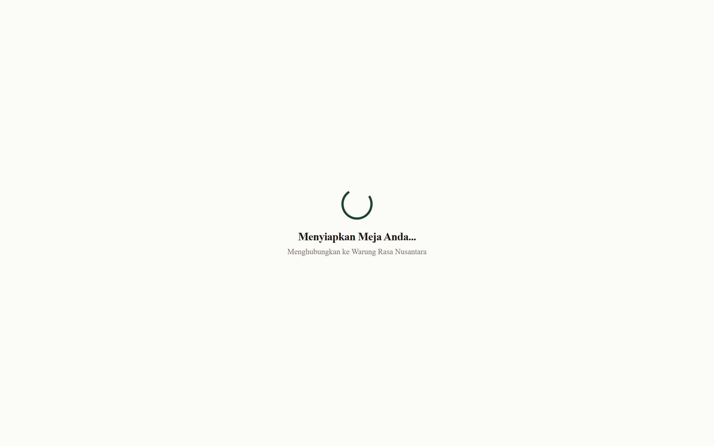
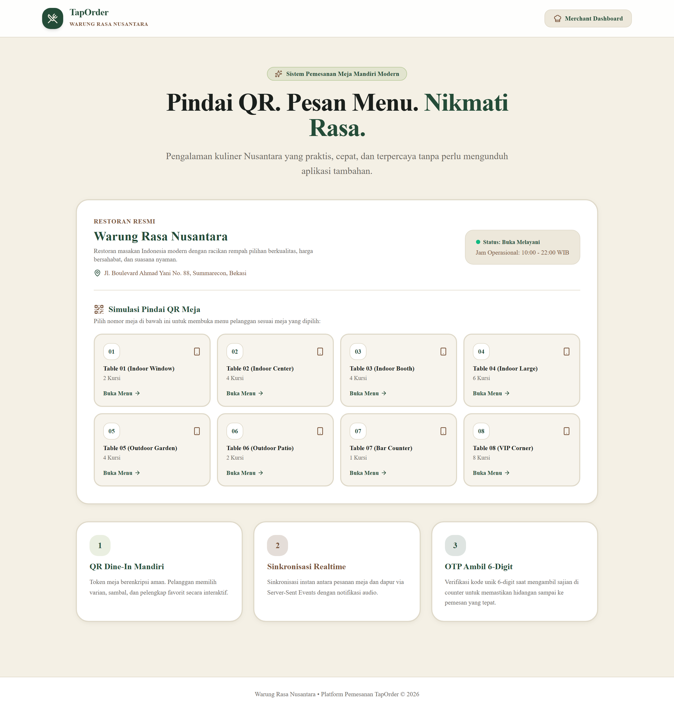
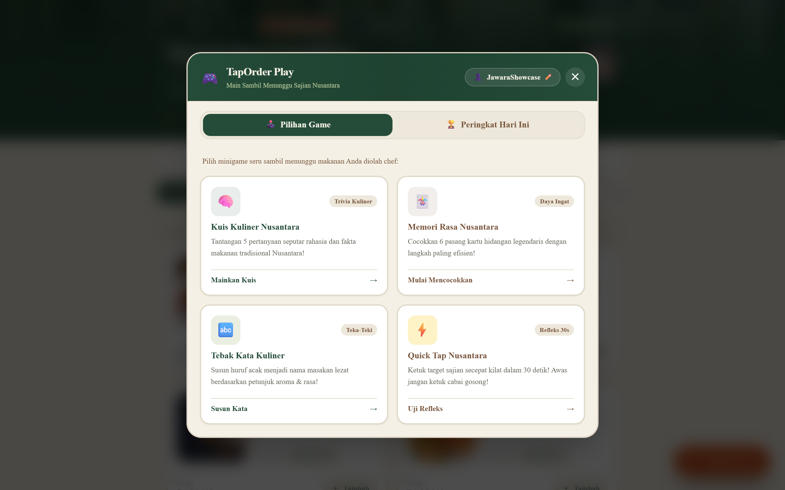
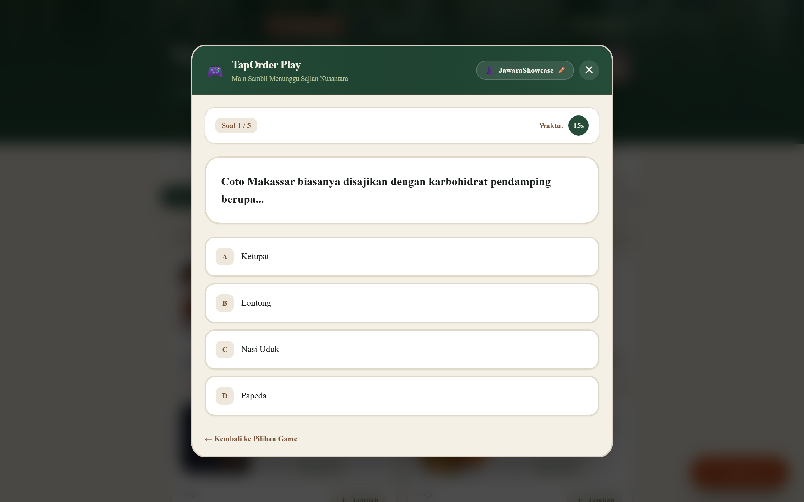
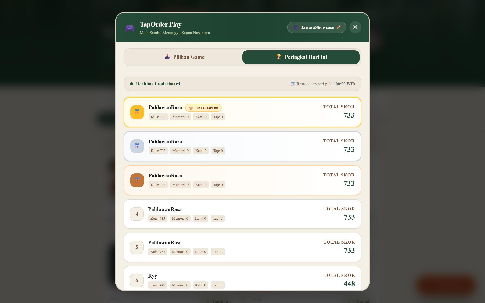
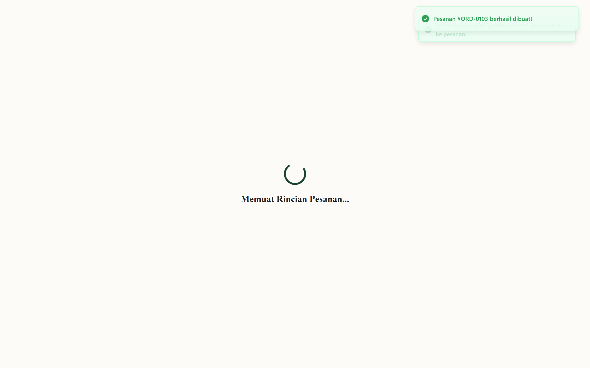
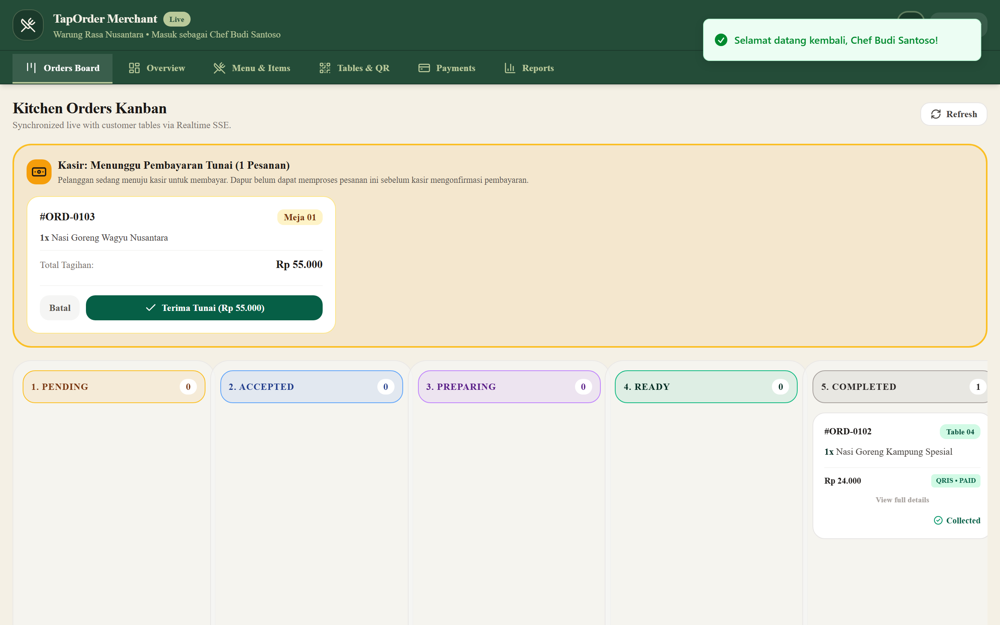
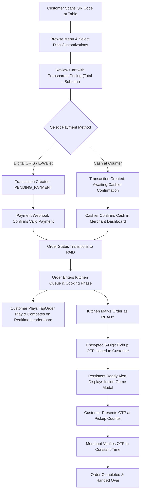

# OneTapOrder — Modern Contactless QR Dining & In-App Engagement Platform

[-000000?style=for-the-badge&logo=next.js&logoColor=white)](https://nextjs.org/)

---

## 📌 Executive Summary

**OneTapOrder** is a high-performance, full-stack contactless restaurant dining platform designed to transform customer experience, kitchen operations, and in-venue engagement. Built with **Next.js 14 App Router**, **TypeScript**, **Tailwind CSS**, and **Prisma ORM**, the system features a **Payment-First architecture**, **authenticated AES-256-GCM encrypted pickup OTPs**, a real-time **Table Service / Waiter Call system**, and **TapOrder Play** — an integrated in-app culinary mini-game center with real-time SSE leaderboards.

*(Audited implementation case study: Warung Rasa Nusantara, Summarecon Bekasi — Modern Indonesian Cuisine)*

---

## 💡 The Core Problems & Architectural Solutions

| Traditional Dining Challenges | OneTapOrder Architectural Solution |
|---|---|
| **Cashier Bottlenecks & Long Queues** | Customers scan a secure, high-entropy QR token linked directly to their physical table, browse an interactive menu, and order instantly from their mobile browser without downloading an app or creating an account. |
| **Unpaid Ghost Orders & Kitchen Waste** | **Payment-First Rule:** Orders are strictly isolated in a `PENDING_PAYMENT` state. Orders never enter the kitchen queue until payment is confirmed via digital payment webhook (QRIS / E-Wallet / Virtual Account) or verified at the cashier counter for cash payments. |
| **Wrong Dish Pickup & Dine-and-Dash** | Once an order is prepared (`READY`), the system issues an authenticated, **AES-256-GCM encrypted 6-digit Pickup OTP**. Cashier/staff must verify this OTP with constant-time equality before handing over food. |
| **Boredom & Churn During Peak Kitchen Delays** | **TapOrder Play:** An in-app mini-game lounge educating customers on Indonesian culinary heritage while they wait. Includes real-time daily leaderboards (resetting at 00:00 WIB) and persistent alert banners when meals are ready. |
| **Hidden Surcharges & Friction** | **Strict Transparent Pricing:** Total Payment = Exact Subtotal of products and add-ons ($0 admin fee, $0 service charge, 0% hidden PB1 taxes). |

---

## 🖼️ Interface Showcase & Visual Walkthrough

### 1. High-Entropy QR Table Entry (`/`)
Customers are welcomed with a clean, responsive simulation and physical QR entry point. Table tokens use cryptographically random hex strings to prevent table spoofing or unauthorized enumeration.

---

### 2. Interactive Digital Menu & Cart Customization (`/menu`)
Showcases 29 authentic Indonesian dishes categorized into mains, noodles, side dishes, snacks, beverages, and desserts. Customers can tailor spiciness, portion variants, and topping add-ons with immediate price calculation.

---

### 3. TapOrder Play — In-App Game Center
An in-app entertainment overlay accessible directly from the menu and order tracking views. Features player nickname validation with offensive language filtering, tabbed navigation, and instant access to 4 distinct games.

---

### 4. Culinary Trivia Challenge ("Kuis Kuliner Nusantara")
A fast-paced trivia challenge featuring 5 randomized questions testing knowledge of regional Indonesian spices, heritage, and origins. Highlights time bonuses, scoring algorithms, and post-game educational trivia cards (*"Did You Know?"*).

---

### 5. Live Server-Sent Events Leaderboard
Real-time Top 10 competitive leaderboard powered by Server-Sent Events (SSE). Displays player ranks, nicknames, and high scores, automatically cycling every 24 hours at 00:00 WIB (*Asia/Jakarta*).

---

### 6. Live Order Tracking & Encrypted Pickup OTP (`/order/[id]`)
Provides live step-by-step order lifecycle tracking (*Pending Payment → Queued → Cooking → Ready → Completed*). When the kitchen marks the dish `READY`, the 6-digit pickup OTP card is illuminated with high-contrast visual cues.

---

### 7. Merchant Kitchen Operations & Realtime Dashboard (`/merchant`)
A unified command center for restaurant staff featuring a real-time Kanban kitchen board, single-click cash payment confirmation, OTP pickup validation, table request notifications, and native Web Audio procedural chimes.

---

## ✨ System Features Breakdown

### 📱 Customer Dining Experience
* **Zero-Install Web Application:** Responsive across all smartphone viewports (tested on iOS Safari, Android Chrome, and Desktop).
* **Multi-Channel Waiter Call:** Floating "Panggil Pegawai" assistance button available across all customer stages (menu browsing, product customization modal, checkout, and tracking) protected by a 60-second client/server anti-spam cooldown.
* **Transparent Checkout:** Instant breakdown showing subtotal, 0 hidden fees, and multiple payment methods (Automated QRIS, E-Wallet, Bank Transfer, and Cash at Cashier).
* **Realtime Reactive Status:** Order progress updates seamlessly without requiring page reloads via persistent SSE streams.

### 🎮 TapOrder Play Minigames
1. **Kuis Kuliner Nusantara:** 5-question trivia with speed multiplier bonuses and educational post-quiz fact cards.
2. **Memori Rasa Nusantara:** 6-pair culinary memory match game balancing total completion time and move count efficiency.
3. **Tebak Kata Kuliner:** Interactive word-guessing game with regional spice clues and hint deduction penalties.
4. **Quick Tap Nusantara:** 30-second reflex challenge with decoy obstacle penalties and server-side anti-cheat click-rate limiting (< 12 clicks/sec).
5. **Persistent Meal Readiness Alert:** When an order transitions to `READY` while a customer is actively playing, a prominent banner immediately appears inside the game modal instructing them to collect their order with their OTP.

### 🛡️ Merchant & Operational Control
* **Five-Stage Kanban Pipeline:** `Menunggu Pembayaran` (Pending Payment), `Antrean Dapur` (Kitchen Queue), `Sedang Dimasak` (Cooking), `Siap Diambil` (Ready for Pickup), and `Selesai` (Completed).
* **Cashier Payment Authorization:** Cash orders remain locked until the cashier physically confirms payment in the dashboard.
* **Cryptographic OTP Verification:** Constant-time hash verification ensures zero timing-attack vulnerabilities during pickup authorization.
* **Synthesized Audio Notifications:** Web Audio API oscillator synthesis plays distinct chime tones for new orders, cash payments, and table calls without external MP3 dependencies.

---

## 🏛️ Architecture & Technology Stack

| Layer | Technology | Details |
|---|---|---|
| **Core Framework** | [Next.js 14](https://nextjs.org/) | App Router, Server Components, and Edge/Node API Route Handlers |
| **Language** | [TypeScript 5.x](https://www.typescriptlang.org/) | Strict type checking end-to-end with zero compilation errors |
| **Styling & Design** | [Tailwind CSS 3.4](https://tailwindcss.com/) | Bespoke 4-color palette: Forest Green (`#244C38`), Warm Brown (`#79543B`), Warm Ivory (`#F4F0E5`), Sage Green (`#B9C99A`) |
| **Icons & Feedback** | [Lucide React](https://lucide.dev/), [Sonner](https://sonner.emilkowal.ski/) | Clean iconography and non-blocking toast notifications |
| **Database & ORM** | [Prisma ORM 5.22](https://www.prisma.io/) | Relational database schema with atomic transactions and referential integrity |
| **Realtime Engine** | Server-Sent Events (SSE) | Multi-channel broadcasting (`orders`, `service-requests`, `leaderboard`) |
| **Cryptography** | Node.js Web Crypto API | Authenticated AES-256-GCM encryption & `crypto.timingSafeEqual` |
| **Schema Validation** | [Zod 3.x](https://zod.dev/) | Strict runtime payload verification for all API endpoints |
| **Audio Engine** | Native Web Audio API | Procedural sound wave generation for acoustic notifications |
| **Test Automation** | [Vitest](https://vitest.dev/), [Playwright](https://playwright.dev/) | 34 automated unit/integration tests & cross-browser E2E suites |

---

## 🔄 End-to-End Customer Flow

---

## 🔒 Confidentiality & Showcase Notice

> **Showcase Repository Notice:**  
> This public repository contains architectural documentation, UI/UX design representations, feature summaries, and interface screenshots for presentation and portfolio evaluation.  
> In accordance with intellectual property and security best practices, application source code, database migrations, and operational credentials remain securely held within private repositories.

---

## 📬 Contact & Inquiries

For technical demonstrations, architecture walkthroughs, or enterprise collaboration inquiries:
- **Developer:** [Ryyakiniku](https://github.com/ryyakiniku)
- **Project:** OneTapOrder Platform
- **License:** All Rights Reserved © 2026 OneTapOrder
